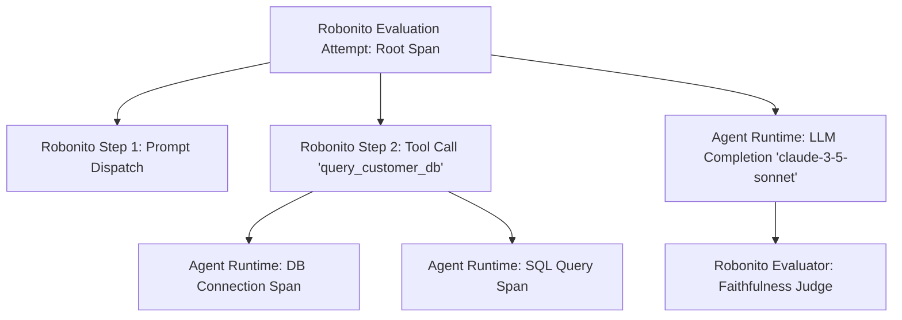

# Robonito Eval with Telemetry & Distributed Tracing

Modern AI agents are complex distributed systems. When an agent fails a test or hallucinates, inspecting the final user-facing text alone is rarely enough to diagnose the root cause. You need to know:
- Did the model spend 12 seconds in a hidden reasoning loop?
- Did the vector database query return empty passages?
- Did a specific tool call fail with a 500 error that the agent silently swallowed?
- How many input and output tokens were consumed at each step in the loop?

Robonito unifies agent evaluation with **OpenTelemetry (OTel)** distributed tracing. Every test run injects standard W3C trace contexts, ingests agent spans over OTLP, aligns timelines, and cites exact trace spans as evidence for every evaluation verdict.

---

## Architecture: Unified Agent Trace Hierarchy

Traditional testing tools treat the agent as a disconnected black box. Robonito stitches its own execution spans and your agent's internal spans into a single, unified trace hierarchy:



Every attempt receives a fresh, globally unique W3C Trace ID. All downstream spans emitted by your agent, framework, or MCP server nest cleanly under the attempt that caused them.

---

## W3C Trace Context Propagation

Robonito automatically injects W3C trace context across all supported target protocols:

| Target Protocol | Carrier | Specification |
|---|---|---|
| **REST / HTTP APIs** | `traceparent` HTTP Header | Standard W3C Trace Context format (`00-<trace_id>-<span_id>-01`). |
| **CLI / Process Executables** | `TRACEPARENT` Environment Variable | Read automatically by OpenTelemetry SDKs in Node.js, Python, Go, and Java. |
| **Model Context Protocol (MCP)** | `params._meta.traceparent` | Included in every MCP `tools/call` JSON-RPC payload, ensuring stdio and SSE servers inherit trace context. |

Because Robonito uses standard W3C headers, any agent instrumented with standard OpenTelemetry libraries (such as OpenInference, Langfuse, or native OpenTelemetry SDKs) automatically captures the context without custom code.

---

## Native OTLP Ingestion Endpoint

Robonito provides a built-in OpenTelemetry collector endpoint running directly on your workspace app server:

- **Endpoint URL:** `POST /app-server/otlp/v1/traces`
- **Supported Encodings:**
  - `application/x-protobuf` (Default for OpenTelemetry exporters)
  - `application/json`

### Configuring Your Agent's OpenTelemetry Exporter

You can route your agent's distributed traces to Robonito using standard environment variables:

```bash
# Point exporter to Robonito's OTLP endpoint
export OTEL_EXPORTER_OTLP_ENDPOINT="http://localhost:4000/app-server/otlp"
export OTEL_EXPORTER_OTLP_PROTOCOL="http/protobuf"

# Authenticate using your Robonito Workspace Ingest Token
export OTEL_EXPORTER_OTLP_HEADERS="x-robonito-ingest-token=rb_ingest_live_948f3b21e8"
```

In Python with LangChain or LlamaIndex:
```python
from opentelemetry import trace
from opentelemetry.exporter.otlp.proto.http.trace_exporter import OTLPSpanExporter
from opentelemetry.sdk.trace import TracerProvider
from opentelemetry.sdk.trace.export import BatchSpanProcessor

# Configure OTLP exporter pointing to Robonito
exporter = OTLPSpanExporter(
    endpoint="http://localhost:4000/app-server/otlp/v1/traces",
    headers={"x-robonito-ingest-token": "rb_ingest_live_948f3b21e8"},
)

provider = TracerProvider()
provider.add_span_processor(BatchSpanProcessor(exporter))
trace.set_tracer_provider(provider)
```


> **Image Update Note:** Add screenshot (`/agentic-testing/telemetry-otlp-config.png`) displaying the workspace OTLP configuration drawer with the token generator and language code snippets.

---

## Workspace Ingest Tokens

To keep your test traces secure, Robonito uses **Workspace Ingest Tokens**:
- Ingest tokens grant permission exclusively to send trace spans; they cannot read data, modify tests, or execute runs.
- Tokens can be rotated or revoked at any time from **Settings → Telemetry & Ingest Tokens**.
- Shared exporters can send all staging traffic safely—Robonito automatically matches incoming spans by Trace ID, keeping traces linked to active test runs and expiring unclaimed traces after 24 hours.

---

## Trace Waterfall & Span Inspection

During and after test execution, the **Trace Waterfall Viewer** lets you explore every millisecond of the agent's reasoning loop:

| Timeline Element | Insights Revealed |
|---|---|
| **Root Attempt Span** | Total elapsed test execution time and overall pass/fail status. |
| **Tool Execution Spans** | Tool name, exact serialized inputs, return payloads, and execution latency. |
| **LLM Inference Spans** | Model name, system prompt, temperature, input token count, output token count, and time-to-first-token (TTFT). |
| **Vector DB Search Spans** | Query string, similarity metric, top-$k$ returned passages, and retrieval duration. |


> **Image Update Note:** Add screenshot (`/agentic-testing/telemetry-trace-waterfall.png`) displaying an expanded waterfall view showing LLM calls, tool spans, and token count badges.

---

## Evaluator Evidence Citations

When an evaluator scores an agent step (e.g., flagging a hallucination or an incorrect tool call), Robonito does not just output an abstract score. Every verdict explicitly cites the exact span and data that caused the decision:

- *"Evaluator **Faithfulness** failed on Claim 3 because retrieved context in Span `span-db-fetch-82` does not substantiate the claim."*
- *"Evaluator **Tool Precision** failed because Span `span-tool-call-14` invoked `export_user_data` which violated the Omission Policy."*

Clicking any citation in the evaluation report jumps directly to that span in the trace waterfall, showing the full raw payload.

---

## Token Budgets & Cost Governance

Testing non-deterministic agents across large evaluation datasets can quickly burn cloud credits if an agent gets stuck in a recursive loop. Robonito provides built-in cost governance:

- **Per-Attempt Token Caps:** Set hard limits on input and output tokens (e.g., max 10,000 tokens per attempt). If exceeded, the run terminates with a `BudgetExceededError`.
- **Durable Operation Receipts:** Every attempt records an immutable cost receipt tracking model family, prompt tokens, completion tokens, and dollar cost based on published provider pricing.
- **Cost vs. Quality Benchmarks:** Compare whether switching from a lightweight model to a frontier model produced a statistically significant gain in task completion to justify the cost increase.

---

## Next Steps

- [Agent Evaluation Workbench](/docs/agentic-testing) — Setting up test runs and candidate comparisons.
- [MCP Testing Guide](/docs/agentic-testing/mcp-testing) — Tool validation and credential slot challenges.
- [RAG Evaluation & Hallucinations](/docs/agentic-testing/rag-evaluation) — Context precision, recall, and claim-level faithfulness.
